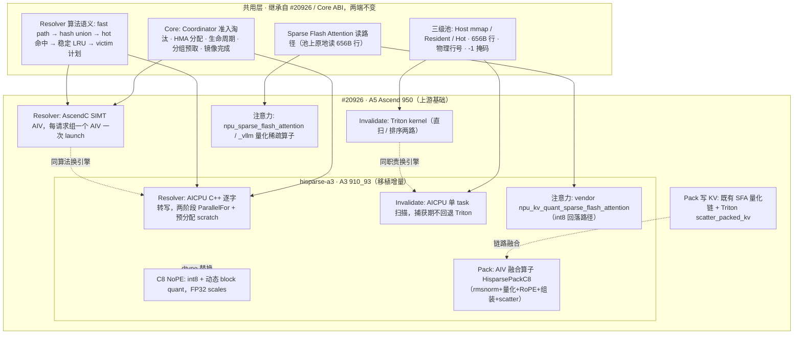

# HiSparse-A3（GitCode）vs PR #20926（vllm-ascend）架构对比

| 项 | PR #20926 | hisparse-a3 |
| --- | --- | --- |
| 仓库 | `vllm-project/vllm-ascend#20926` | `gitcode.com/SamWang921/hisparse-a3` |
| 定位 | HiSparse Ascend 后端**上游基础**，合入 vLLM Core 可插拔 ABI | 基于 `pr20926 @ 5a54eb466` 的 **A3 移植增量工作集**，独立仓 + 补丁序列 |
| 目标硬件 | Ascend 950（A5），SIMT-capable CANN 9.2 | Ascend 910_93（Atlas A3），CANN 9.2.1，TP16 / DP1，无 MTP |
| 模型 | DeepSeek 系 MLA 为主，Main/Indexer dtype 独立可选 | GLM-5.2-w4a8c8（同族验证）/ GLM-5.3-Flash（生产） |
| 交付形态 | 直接在 vllm-ascend 仓内：`hisparse/` 后端包 + `csrc/hisparse` + patch 接线 | 独立仓 `ops/`（私有 OPP 编译）+ `integration/patches/0001–0005` 打回 base 分支 + torch adapter 副本 |

## 一、两者关系

hisparse-a3 **不是另一套稀疏注意力框架**，而是 PR #20926 数据面在 A3 上的落地移植：

- 基线就是 #20926 分支提交 `5a54eb466`（2026-11-09），仓内只包含在此之上的增量；
- Core 侧生命周期、三级池布局、656B 行契约、resolver 算法语义、注意力读路径全部沿用上游；
- 差异集中在**算子实现与 dtype 选择**：A5 上由硬件/编译链免费提供的能力，在 A3 上不可用，需要逐项换成 AICPU / AIV / int8 软件实现。

## 二、总体架构对照

## 三、逐维度对比

| 维度 | PR #20926（A5 上游基础） | hisparse-a3（A3 移植） |
| --- | --- | --- |
| 存储层级 | Host 锁页映射池（每 rank 私有，ACL AIV 注册）→ Resident 设备页表 → Hot 共享 slab | 同一三级池；Host 为 CPU mmap；A3 上 `aclrtHostMemMapCapabilities` 未实现，需 `HISPARSE_SKIP_HOSTMAP_CAP` 跳过 |
| 行格式 | 656B：512B NoPE + 128B BF16 RoPE + 16B（4×FP32）scales | 行长与字段布局完全相同；仅 NoPE 字节语义由 fp8 改为 int8 |
| Resolver | AscendC SIMT 内核（`csrc/hisparse/hisparse_resolver.cpp`，UB 预算 `HISPARSE_RESOLVER_UB_BYTES=175616`，目标 `dav-3510`） | AICPU C++ 逐字串行转写（kernel 558 行）；Phase 1 行级 ParallelFor 处理 fast-path，Phase 2 串行共享 hash scratch；scratch 按 device 缓存复用，图捕获无堆分配 |
| 写槽失效 | Triton `invalidate_kernel` / `invalidate_written_slots_sorted` 两路 | AICPU `HisparseInvalidateAicpu`：(token, group) 单元 ParallelFor 扫描设备地址表；无 capture 门，图里录 AICPU task |
| C8 NoPE dtype | 原生 E4M3FN fp8；门控拒绝 INT4 / TurboQuant / INT8 格式 C8 | int8（A3 无 fp8 block quant，`dst_type=fp8` 报 161002）；门控放宽到 `(E4M3FN, int8)` |
| 写 KV / Pack | 复用既有 SFA 量化链（slice/rmsnorm/interleave rope/block quant/concat）+ Triton scatter | 新写 AIV `HisparsePackC8`：一行一核，融合 rmsnorm、4×128 块 int8 量化、RoPE lane 代数、656B 组装与 scatter；`HISPARSE_PACK_FUSED=1`，rows≤64 的 decode 路径，prefill 与 A5 回退原链 |
| 注意力 dispatch | BF16 走 `npu_sparse_flash_attention`；C8 走 `npu_kv_quant_sparse_flash_attention_vllm` | fp8 仍走 `_vllm` 定制算子；int8 回落 vendor 原生 `torch_npu.npu_kv_quant_sparse_flash_attention`（TND + 绝对物理行号 + `key_quant_mode=2` 契约同构） |
| Gather / 回填 | 复用 Resident 字节拷贝 gather，保留各自无效行契约；D2H 分批 2047 上限 | 同样走 gather；新增 `HISPARSE_GATHER_CHUNK_BYTES=256 MiB` 分块，避免 4.6–37 GiB 临时张量 OOM |
| 模型接线 | DeepSeek V2/V3 MLA 包装；index-group builder 挂 Core `MLAModules` ABI | 额外 GLM-5 模型适配：`models/glm5next/{attention,kda,model}.py` 导入回退；patch 0005 在 vLLM 树补 GLM-5 配置类 |
| 测试验收 | UT CPU + 一卡 NPU e2e；CI 路由 ready-a5 | PR 自带 17 项 op 测试在 A3 通过；单卡探针（int8 SFA 数值、pack 逐位/1 ULP 对齐、6 组寻址对抗用例）；12–16 token 连贯性 + GSM8K 4-shot@4096 |
| 性能口径 | 基础合入阶段，整机正确性/精度/最大并发资格待完成；未给步时账本 | 完整 A/B 矩阵：4k bs16 ON 55.3 vs OFF 38.9 ms/步（+16.4 ms / +42%），含逐项归因账本 |

## 四、四项 A3 增量（M1–M4）逐项对照

| # | 改动 | A5 / #20926 原状 | A3 替代实现 | 触发原因（A3 能力缺口） | 实测收益（4k bs16） |
| --- | --- | --- | --- | --- | --- |
| M1 | int8 C8 直读桥 | C8 NoPE 必须原生 E4M3FN；注意力走 `_vllm` 量化算子 | dtype 门放宽到 int8；int8 回落 vendor 原生量化稀疏注意力；`c8.py`/`backend.py` 同步放宽 | A3 无 fp8 block quant（161002），无原生 int8 KV cache | 170.8 → 128.1 ms/步；TTFT 17.3 → 9.8 s |
| M2 | AICPU 解算器 | SIMT AIV 内核，编译链原生支持 | AICPU C++ 转写上游算法；`EXEC_NPU_CMD(aclnnHisparseResolveUnionAicpu)`；geometry-generic 门（topk=2048、block=128） | `dav-c220` 编译目标在 CANN 9.x 无 `asc_simt` 支持，SIMT 编译直接失败，offload 无法启动 | 图内 264 µs/次 × 20.8 次/步 = +5.24 ms/步；服务零错误、语义逐位对齐 |
| M3 | AICPU 写槽失效 | Triton 扫描，A5 上发射开销可接受 | AICPU 单 task 全扫描；设备地址表裸指针解引用；良性竞争写 -1 | A3 上 2688 program × ~11 µs 发射 ≈ 25.7–30 ms/步，独占一流与计算零重叠 | 25.7 → 0.55 ms/步 |
| M4 | AIV 融合 C8 pack | 6–7 个碎 kernel 链（slice/rmsnorm/rope/quant/concat/scatter） | AIV 单算子融合 rmsnorm、int8 块量化、RoPE、656B 组装与 scatter；输出 rope/latent/scales 三分量 | A3 无原生 int8 KV cache，每行都要软件构建 656B 行，碎链 ≈ +5.9 ms/步 | op 388 → 21.4 µs（18×）；e2e 再省 2.5 ms/步 |

## 五、两端共用、未被改动的契约

1. **三级池职责**：Host 存完整历史、Resident 存每请求已驻留历史、Hot 存本步 top-k 命中行；resolver 同时产出搬移清单与注意力索引。
2. **656B 行寻址**：任何路径（Host/Resident/Hot）按同一行长寻址；注意力只拿 int32 物理行号，`行号 → pool_base + row×656`，无间接表。
3. **Resolver 算法语义**：fast path 整请求驻留直出；miss 行开放寻址 union 并保留最小首次引用；hot 命中置 `kHit|slot`；稳定 LRU 分区；victim 按首次引用顺序回填；`-1` 填充与有效长度 counts。
4. **Core 生命周期**：准入/淘汰、请求寿命、分组预取（含 MTP 校验）、镜像完成与 draft finalizer、内存预算口径均由 Core 持有，后端只供应算子与视图。
5. **捕获安全约束**：所有算子图捕获内无堆分配、输出预分配、无 host 同步；scratch/workspace 预分配复用。

## 六、关键差异与遗留风险

**A3 结构性成本（hisparse-a3 账本，4k bs16 稳态）**

| 项 | ms/步 | 说明 |
| --- | --- | --- |
| Resolver AICPU | +5.24 | 20.8 × 264 µs，下一最大单项；后续可 AI-Core 化 |
| int8 KV 行构建（M4 后） | ≈+3.4 | 融合后残留；prefill 仍走 bf16 桥，未融合 |
| 注意力净差 | +2.44 | int8 SFA 122 µs/层 vs bf16 SFA 91 µs/层（1.34×） |
| 量化 Q 路径 | +2.10 | QuantBatchMatmulV3 254→334 次/步 |
| reduce_scatter | +1.31 | 3.22 vs 1.91 |
| gather_rows | +0.66 | 77.8 × 9 µs |
| invalidate | +0.55 | 0.8 × 656 µs |

**工程与口径注意**

- **集成形态**：a3 算子走私有 OPP 独立构建，不经 in-tree `csrc/build_aclnn.sh`（实验机该脚本为 stub）；OPP 装器共享库是累积产物，必须全家族一次构建。
- **图模式 padding 税**：capture sizes 被 TP 对齐收敛为 `[16]`，bs1–15 padding 到 16 重放 FULL 图；慢的是 15 个 dummy 请求稀释热区，不是 eager；主口径以 bs16 为准。
- **churn 格噪声**：16k/32k × bs16 两臂轮间散布 ±10 ms，融合收益需 fresh-server + 受控 churn 协议才能定论。
- **量化角落**：pack scale 用 `Muls` 倒数，与 vendor `amax/127` 有 1 ULP 差；codes ≤7/8192 差 ±1，属量化噪声级，未做逐位强制。
- **范围边界**：#20926 明确排除 INT4 / TurboQuant / INT8 格式 C8；a3 的 int8 C8 是 A3 硬件约束下的必要变体，不属于上游已认证范围。
- **未覆盖**：prefill 的 int8 行构建尚未融合（M4 仅 decode rows≤64）；A2/A3 之外的设备资格、外部 P/D 传输、CP 均未在两端范围内。

## 七、结论

> **同一套 HiSparse 数据面与 Core 契约，两套算子实现。**

- #20926 是面向 A5(950) 的后端基础：SIMT 解析器、Triton 缓存算子、原生 fp8 C8，框架接线完整但整机资格待认证；
- hisparse-a3 是把同一套数据面搬到 A3(910_93)：因 SIMT 编译、fp8 block quant、原生 int8 KV cache、Triton 发射开销四项能力缺口，分别用 AICPU 解析器、AICPU 失效、int8 直读、AIV 融合 pack 替代；
- 两端共享三级池、656B 行契约、resolver 算法语义与注意力读路径；分歧只在引擎选择、dtype 与集成打包方式。

## 来源

- PR：`https://github.com/vllm-project/vllm-ascend/pull/20926`（头部分支 `feat/hisparse-foundation-20261104`，`48e4b4a63a`）
- 对比仓：`https://gitcode.com/SamWang921/hisparse-a3`（main `3d593603`，基线 `pr20926@5a54eb466`；数据口径见仓内 `docs/06-performance.md` 与 `docs/A3-REPORT-20261111.md`）
