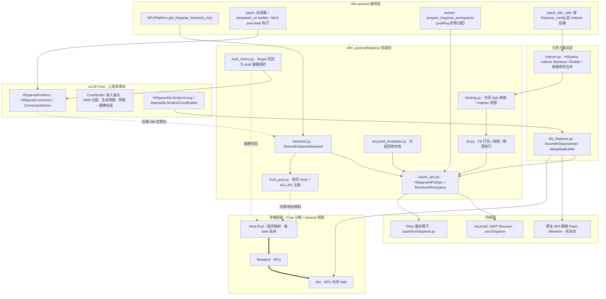
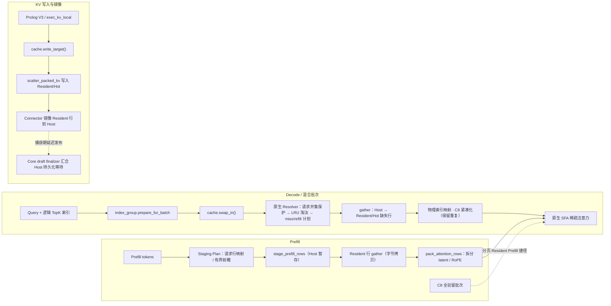
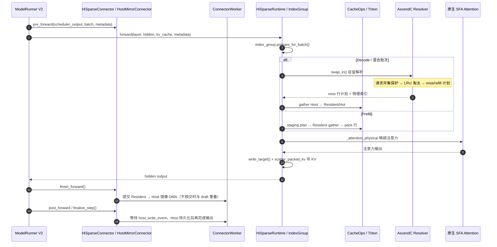

# PR #20926 — HiSparse Ascend Backend Foundation 架构分析

| 项 | 内容 |
| --- | --- |
| 标题 | [Feature][HiSparse] Add Ascend backend foundation |
| 状态 | open，未合并；base `main` |
| Head | `zhenwenqi2024/feat/hisparse-foundation-20261104` @ `48e4b4a63a` |
| 规模 | 54 files，+6157 / −78（API 口径；patch 序列 119 commits） |
| 标签 | module:core · module:ops · module:tests · documentation · ci/build · ready-precise |
| 上游 vLLM | `24420b7a341af37a9bc3186e6fc6062512e0aa58` |

## 概览

本 PR 为 vLLM Core 已合入的 HiSparse 可插拔接口补上 **Ascend NPU 后端**：把稀疏注意力的活跃 KV 行留在 NPU Resident/Hot 存储，缺失行从 Host 内存回填。Core 侧负责 HMA 分配、Coordinator 准入/淘汰、请求生命周期、分组预取与镜像完成；Ascend 侧提供驻留解析、映射 Host 传输、共享 slab 布局适配，并复用既有 SFA 注意力算子。**注意力核心算术未改动，也不依赖未合入的 vLLM Core 补丁。**

| Core 持有（上游，不改） | Ascend 提供（本 PR） | 保持不变 |
| --- | --- | --- |
| HMA 分配、Coordinator 准入/淘汰、请求生命周期、#63801 分组预取（含 MTP 校验）、Host 镜像完成与 draft finalizer、内存预算口径、`write_target()` 缓存与分组失效 ABI | 原生驻留解析器、锁页映射 Host 池、Triton 缓存/拷贝/失效算子、共享 slab 规格与视图适配、C8 打包与物理索引桥、SFA 执行接入与流/事件围栏 | 既有原生 SFA / 量化 Flash Attention 算子、RoPE 与量化器、Attention 算术；Triton 与原生注意力内核均未被本组织改动 |

## 一、分层架构

## 二、前向数据流

## 三、前向生命周期时序

## 四、模块职责清单

| 模块文件 | 职责 | 归属层 |
| --- | --- | --- |
| `platform.py` | `get_hisparse_backend_cls()` 返回 `vllm_ascend.hisparse.backend.AscendHiSparseBackend`，由 Core 后端工厂实例化。 | 接线 |
| `hisparse/backend.py` | Core 后端 ABI 实现：可用性检查（装 Host 池、引导 custom-op、加载 DMA 扩展与 Resolver、挂 Worker DMA 钩子）、Host 锁页注册、cache_ops 构造（leader/follower 共享 scratch）、D2H 分批提交（2047 上限、失败保留现场）、profiling 前 workspace 预分配。 | Ascend 后端 |
| `hisparse/binding.py` | 共享 slab 规格对齐（block stride / packed row 对齐）、Indexer 规格校验、FP8 K/scale 页视图别名、Indexer C8 按页 stride 写入、稠密页寻址视图绑定。 | Ascend 后端 |
| `hisparse/cache_ops.py` | `HiSparseNPUOps` 实现上游算子 ABI：驻留解析、compact/plan gather、写槽失效（直扫或排序两路）、Resident 行拷贝、注意力行打包、KV 散布；`ResolverWorkspace` 持有每组固定 scratch。 | Ascend 后端 |
| `hisparse/c8.py` | C8 行打包（512×E4M3FN NoPE + 64×BF16 RoPE + 4×FP32 scale = 656B）、保留 HMA 间隙的 TND 存储视图、虚拟页行→物理连续行映射、稳定紧凑化（含重复）。 | Ascend 后端 |
| `hisparse/host_pool.py` | 每 rank 私有锁页 Host 池；`aclrtHostRegister` AIV 映射与 device 地址换算；包装 Core `allocate_pinned_host_pool` 分配钩子，保留 Core 释放归属。 | Ascend 后端 |
| `hisparse/host_mirror.py` | Target-only Host 写回与 drafting 重叠：draft/Target 行与 Host 区间不相交、组隔离与布局校验；forward ready / host_write 事件围栏，输出流等待，在 Core draft finalizer 汇合持久化。 | Ascend 后端 |
| `hisparse/recycled_invalidate.py` | 回收块分组失效，复用 Core 分组指针表 ABI；A5 上预热编译，块 ID 二分查找；流/表地址/dtype 多重守卫，不满足则回退 Core 原路径。 | Ascend 后端 |
| `attention/sfa_hisparse.py` | 稀疏 SFA 执行桥：元数据构建与 token→请求行映射、Prefill 暂存计划、Prolog 直写、BF16/C8 注意力调用、C8 全驻留分页 Prefill 捷径、捕获期镜像抑制。 | 注意力集成 |
| `attention/indexer.py` | `AscendHiSparseIndexerBackend` / `AscendHiSparseIndexerMetadataBuilder`：把 Indexer 写入映射到 HiSparse 共享设备分配；规格合并保留 Core 缓存角色、padding 与 stride 对齐。 | 注意力集成 |
| `patch/worker/patch_attn_utils.py` | 按 `hisparse_config` 在 `AscendHiSparseIndexerBackend` 与 `AscendSFAIndexerBackend` 间选择；模型构造上下文退出后不被后续模型改写。 | 接线 |
| `worker/v2/model_runner.py` | 用 `overlap_target_host_mirror(runner)` 包装 Core connector；镜像阶段事件围栏与 draft 重叠判定接入 Runner 前向。 | 接线 |
| `worker/v2/input_batch.py` | 复用 Core `combine_sampled_and_draft_tokens`，去掉重复的 CPU token 组合逻辑。 | 接线 |
| `csrc/hisparse/hisparse_resolver.cpp` | AscendC SIMT 请求并集 LRU 解析器：每个连续请求组一个 AIV、一次 launch；UB 预算由 CMake `HISPARSE_RESOLVER_UB_BYTES` 约束。 | 原生内核 |
| `ops/triton/hisparse.py` | gather / 失效 / 行打包 / 散布等 Triton 缓存算子；不含注意力算术。 | Triton 内核 |
| `ops/triton/sfa_indexer_store.py` | Indexer K 与 FP32 scale 按页 stride 写入。 | Triton 内核 |
| `patch/platform/patch_kv_cache_coordinator.py` | HiSparse 组绕过 Ascend 私有缓冲预算修正与混合协调器，走 Core 协调器与共享 slab 预算；无消费者的 Resident/Hot 组跳过元数据构建。 | 接线 |
| `patch/worker/patch_deepseek_v2.py` | 模型侧 index-group builder 经 Core 既有 `MLAModules.index_group_builder` 字段传递，保持 MLA 包装 ABI。 | 接线 |
| `ops/mla.py` | post-load 权重钩子兼容 Core 无参 ABI，保留 Ascend 主分支显式激活 dtype 调用约定。 | 接线 |
| `ops/rotary_embedding.py`、`attention/context_parallel/sfa_cp.py` | 移除 HiSparse opt-in 与执行阶段/拓扑守卫链；CP 转发同一上下文，兼容 builder 间共享 RoPE 元数据。 | 接线 |

## 五、支持范围与边界

**当前支持**

- Model Runner V2（`VLLM_USE_V2_MODEL_RUNNER=1`）
- Ascend 950，SIMT-capable CANN 9.2 工具链
- BF16 KV；或原生 E4M3FN C8 KV + FP32 scales
- Main 与 Indexer KV dtype 可独立选择
- 每 rank 私有 Host 池 + Core eager Host mirror
- TopK 满足既有 SFA 要求（128 整除）

**当前排除 / 未认证**

- INT4 KV、TurboQuant、INT8 格式 C8
- 上下文并行（CP）、外部 P/D 传输
- A2 / A3 设备未在本批结果中认证
- 无 Triton resolver 回退；解析器仅原生 AscendC
- 最终头 NPU 整机正确性、数据集精度与最大并发资格仍待完成

## 六、关键实现要点

- **预算与 workspace**：Worker 在自动 profiling 与显式 KV-size 分支之前调用一次 `prepare_hisparse_workspaces`；Resolver scratch 经 WorkspaceManager 按 index group 持久复用，follower 共享 leader；C8 length 张量按 binding 独立持有，纳入 Core 既有内存预算口径，不重复实现预算公式。
- **解析器语义**：设备上先保留完整 MTP query 行并集，再选择 LRU 受害者；在设备上产出 refill 计划；Hot 容量需同时容纳 int16 LRU 表示（≤32768 行）与编译目标 UB 预算。
- **C8 Prolog 直写**：既有 SFA 选择原生 C8 Prolog V3 时，默认直写 Core `write_target()` 缓存；缩短的有效槽前缀以 -1 填充，复用既有 device producer 做 replay padding，去掉 runner opt-in 绑定与 Prolog staging/scatter 分支。
- **镜像重叠**：仅在绑定 HMA 层/页归属与 draft 组隔离源/目的行、Host 区间不相交时，Target-only Host 写回可与 drafting 重叠；不快照 KV payload，输出持久化依赖在 Core draft finalizer 汇合。
- **捕获期语义**：Graph capture warmup 不发布真实 Connector 步的 Host mirror；仅真实 forward 调用 `finish_kv_update`，重复镜像错误仍保持可见。
- **复用 Core 能力**：分组预取（含 MTP 校验）、Resident 字节拷贝 gather（保留各自无效行契约）、分组指针表失效、slot-dtype 匹配与行 DMA 准备，均带完成与覆写围栏。
- **RoPE 共享**：兼容的普通 SFA 与 Indexer builder 在一次 metadata build 内共享 RoPE 元数据；位置/表/目的端归属与版本变化即失效，自定义 provider/callback 为写边界。

## 附：来源与口径

- 来源：GitHub PR `vllm-project/vllm-ascend#20926`（patch 序列 119 commits，头部提交 `48e4b4a63a`）；职责与边界依据 PR 描述、头部分支最终源码与 diff 梳理。
- PR 内性能与 miss 计数为分场景记录的软件观测，不等同物理 DMA 测量或整机结论；零 miss 的 3% TPOT 目标仅在对应 workload 与配置下成立。
